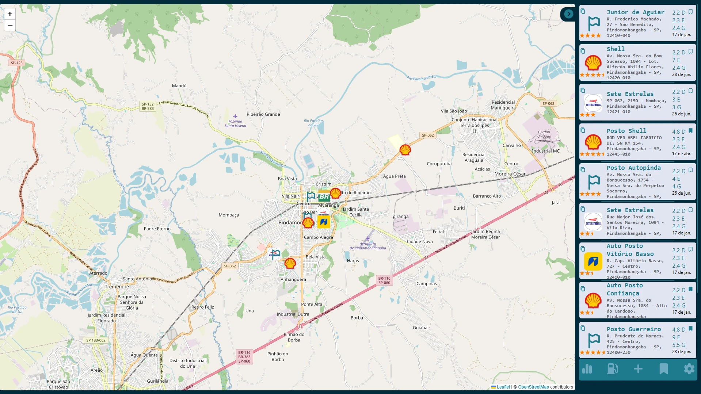

# ⛽ Ecom-Web



**Ecom-Web** é uma aplicação web que permite aos usuários localizar postos de combustíveis em um mapa interativo, visualizar preços atualizados, avaliações e favoritar seus postos preferidos. Desenvolvido com React.js e outras tecnologias modernas, o projeto oferece uma experiência responsiva e amigável.

## 🚀 Funcionalidades

- Visualização de postos de combustíveis em mapa interativo
- Exibição de preços médios, mínimos e máximos dos combustíveis
- Avaliações de usuários sobre os postos
- Favoritar postos para acesso rápido
- Busca e filtro de postos por nome ou ID
- CRUD completo para gerenciamento de postos (restrito a usuários autenticados)
- Integração com a API da Microsoft Maps (Bing)
- Sistema de login e autenticação com Firebase
- Tela de configurações de conta
- Tela de splash animada
- Design responsivo, adaptado para instalação como PWA na tela inicial

## 🛠️ Tecnologias Utilizadas

- [React.js](https://reactjs.org/)
- [Leaflet.js](https://leafletjs.com/) com [Bing Maps API](https://www.microsoft.com/en-us/maps)
- [Tailwind CSS](https://tailwindcss.com/)
- [Firebase](https://firebase.google.com/) para autenticação
- [Supabase](https://supabase.com/) como banco de dados
- [Lordicon](https://lordicon.com/) e [Flaticon](https://www.flaticon.com/) para ícones
- Design elaborado com Figma e Photoshop
- Paleta de cores selecionada via [Coolors](https://coolors.co/)

## 📁 Estrutura do Projeto

```bash
Ecom-Web/
├── public/
│   ├── index.html
│   └── ...
├── src/
│   ├── assets/
│   ├── components/
│   ├── pages/
│   ├── App.jsx
│   └── main.jsx
├── .gitignore
├── config.yml
├── package.json
├── package-lock.json
└── README.md
